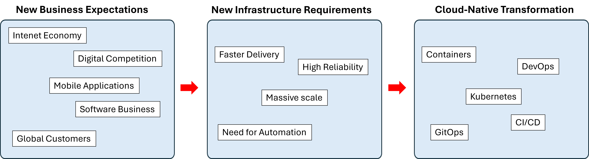
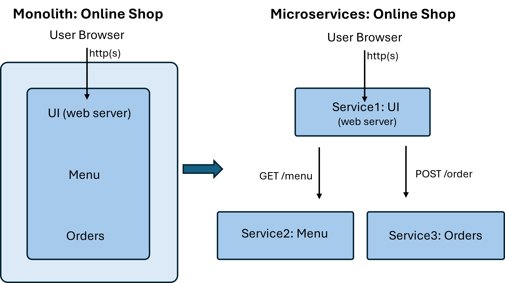
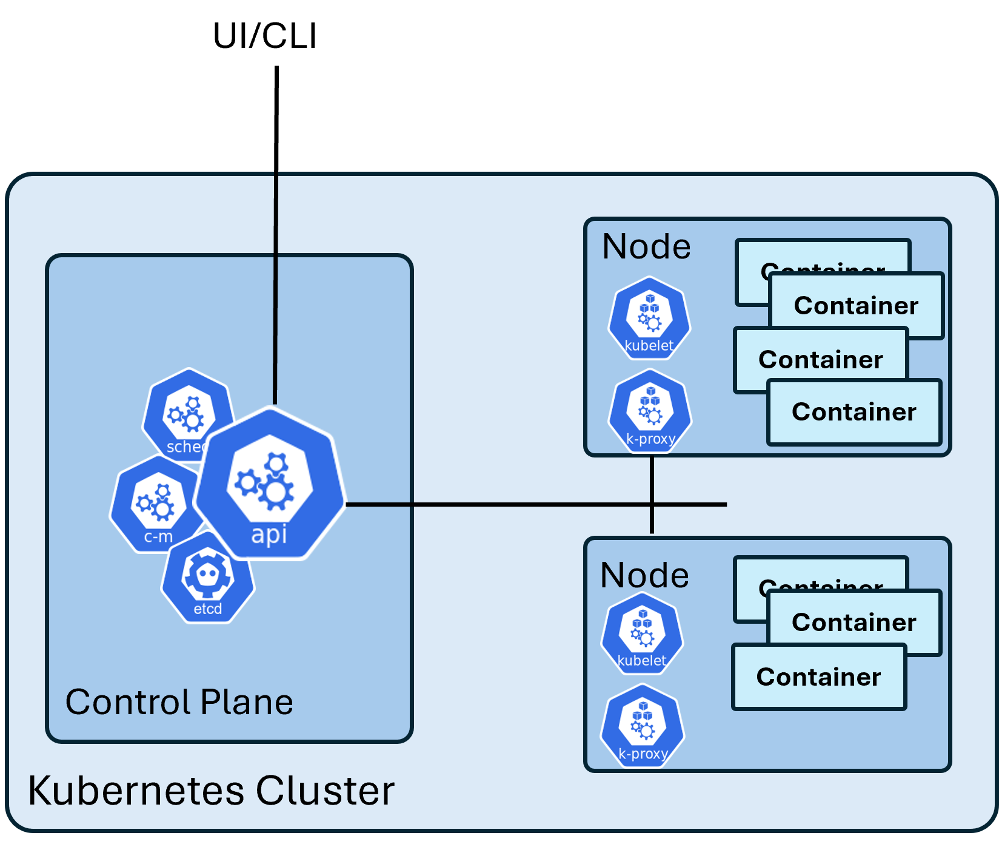

# Introduction to Cloud-Native Infrastructure

## From Traditional IT to Cloud Native

Traditional IT infrastructure was built around monolithic applications, manually managed servers, fixed resource allocation, and infrequent software releases. These approaches worked well when applications served a limited number of users, workloads were predictable, and software changed relatively slowly.

Over time, business expectations changed dramatically. The rise of the internet, smartphones, cloud services, and digital business models transformed software from a supporting tool into a primary way organizations create value and compete. As a result, businesses increasingly demanded:

- Faster time-to-market for new features and services.
- Always-on digital services with minimal downtime.
- Global reach and the ability to serve users anywhere.
- Rapid response to changing customer demand and market conditions.
- Continuous innovation, where software became a key competitive advantage.

These business requirements exposed the limitations of traditional IT infrastructure. Organizations needed to:

- Scale applications dynamically to support growing and unpredictable demand.
- Deliver software faster through frequent releases and automation.
- Improve reliability through self-healing and automated recovery.
- Use infrastructure more efficiently to reduce costs.
- Simplify operations through standardization and automation.

__Cloud-native computing__ emerged because modern businesses needed faster delivery, greater scalability, higher reliability, and more efficient operations than traditional IT infrastructure could provide. Cloud-native computing makes it possible to build and operate applications that can scale efficiently, recover automatically from failures, and be updated rapidly. It combines containers, automation, distributed systems, and modern software delivery practices into a unified operating model.

 
          
## From Monoliths to Microservices
A key part of the cloud-native transformation is the shift from monolithic applications to microservices architectures. In a monolithic application, all functionality is implemented and deployed as a single unit. While monoliths are often simpler to build initially, they become harder to maintain as applications grow. Common challenges include: 

- Limited scalability because the entire application must be scaled together.
- Slower development and releases due to tightly coupled components.
- Lower resilience because a failure in one area can affect the whole application.
- Technology lock-in since all components typically use the same technology stack.

Microservices address these limitations by decomposing an application into small, independent services, each responsible for a specific business capability and communicating through APIs. This approach provides:

- Independent scaling of individual services based on demand.
- Faster development through parallel work by multiple teams.
- Improved resilience by isolating failures to individual services.
- Technology flexibility to use the most suitable language, framework, or database for each service.
- More frequent deployments without redeploying the entire application.
- Better alignment with cloud platforms and distributed environments.

Microservices and containers are complementary concepts. Microservices define how an application is structured, while containers define how services are packaged and run. In a typical cloud-native application, each microservice is packaged into its own container, and platforms such as Kubernetes are used to deploy, scale, and manage these containers across a cluster. 

## Linux as the Foundation of Containers

Most container platforms and Kubernetes clusters run on Linux because containers rely on Linux kernel features:

- Namespaces provide isolation between processes and system resources.
- cgroups control resource usage such as CPU and memory.
 
These concepts allow multiple isolated applications to run on the same operating system while sharing the same kernel. A container is much lighter than a virtual machine, it is an isolated Linux process with defined resource limits.  

Modern applications must run consistently across developer laptops, test environments, data centers, and cloud platforms. Historically, applications often behaved differently between environments, leading to the classic problem:"It works on my machine." **Containers** solve this problem by packaging an application together with its code, dependencies, libraries, and runtime configuration. As a result, the same container can run consistently across different environments. Because containers share the host operating system kernel, they are typically smaller, faster, and more efficient than virtual machines.
 
**A container image** is a reusable template used to create containers. It is a blueprint that contains the application, dependencies, and runtime environment. Multiple containers can be started from the same image. Images are commonly built using a Dockerfile. Container images are stored in **container registries**, such as:

- Docker Hub
- GitHub Container Registry (GHCR)
- Amazon Elastic Container Registry (ECR)
- Azure Container Registry (ACR)

Although often used together, Docker and Kubernetes solve different problems. Docker made containers easy to build and use. Kubernetes builds on this foundation by automating the deployment, scaling, networking, and management of containers across a cluster.
| Docker | Kubernetes |
|--------|------------|
| Builds images | Deploys applications |
| Runs containers on a server | Runs containers across many servers |
| Used by developers | Used by platform and operations teams |
| Focuses mainly on individual containers | Focuses on application orchestration |

Docker is primarily a developer tool for building and testing container images. Kubernetes is a platform for running and managing containers at scale.  

## Kubernetes
Kubernetes (K8s) was released by Google in 2014 as an open-source platform for managing containerized applications. It was inspired by Google's internal systems used to run applications at massive scale. In 2015, Kubernetes was donated to the Cloud Native Computing Foundation (CNCF) and quickly became the industry standard for container orchestration. Today, Kubernetes is the foundation of modern cloud-native platforms and is widely used to deploy, scale, and manage applications in the cloud.

Kubernetes is only one component of a cloud-native platform. While Kubernetes provides the core platform for running and managing containers, production environments require many additional capabilities such as networking, security, continuous delivery, logging, monitoring and observability. Kubernetes is rarely used alone. It serves as the foundation upon which the broader cloud-native platform is built.

The Cloud Native Computing Foundation (CNCF) hosts a large ecosystem of open-source projects that complement Kubernetes (https://landscape.cncf.io/).

### Why Kubernetes?
Containers solved application packaging and portability, but managing large numbers of containers introduced new operational challenges. While a few containers can be managed manually, modern applications may run hundreds or thousands of containers across many servers. Organizations needed a platform that could:

- Deploy containers automatically across a cluster
- Recover from failures by replacing unhealthy containers
- Scale applications based on demand
- Provide networking and service discovery
- Offer a consistent deployment platform across environments

Kubernetes was created to address these challenges through container orchestration. It has become the standard platform for running cloud-native applications. Major Kubernetes platforms include Amazon EKS, Google GKE, Azure AKS, and Red Hat OpenShift. Just as a traditional operating system abstracts the complexity of a single computer, Kubernetes abstracts the complexity of running applications across many servers.

| Traditional Operating System | Kubernetes |
| -----------------------------|------------|
| Manages processes | Manages containers |
| Manages CPUs and memory | Manages nodes and cluster resources | 
| Manages local storage | Manages persistent storage |
| Manages network interfaces | Manages cluster networking | 
| Uses a kernel for coordination | Uses a control plane for coordination |

Without Kubernetes, teams would need to manually decide where containers run, monitor failures, handle scaling, and manage networking. Kubernetes automates these tasks, making it practical to operate modern cloud-native applications at scale.

### Kubernetes Architecture

A Kubernetes cluster consists of a control plane and one or more worker nodes. The control plane is the brain of the cluster. It manages the cluster, schedules workloads, tracks system state, and continuously ensures that the cluster matches its desired configuration. Worker nodes provide the execution environment for applications by running containers and the workloads assigned by the control plane.  

A core Kubernetes concept is **desired state**. Instead of manually managing running applications, administrators declare how the system should look. Kubernetes continuously compares the actual state with the desired state and automatically takes corrective actions when they differ. For example, if a container or node fails, Kubernetes automatically replaces the affected workload. This abstraction allows applications to run without needing to know:

- Which server they are running on
- Which node currently hosts their container
- How traffic reaches them
- Where their data is physically stored

By abstracting the underlying infrastructure, Kubernetes provides a consistent platform for deploying, scaling, and operating applications across clusters of any size.

Kubernetes provides comprehensive official documentation, available at https://kubernetes.io/docs/home/, which can be used as a reference throughout the course.

## Cloud-Native Applications 
Cloud-native is an approach to building, deploying, and operating applications in cloud environments. Cloud-native applications are designed to scale, adapt, and recover quickly in dynamic environments. They are typically:

- Containerized
- Built as microservices
- Loosely coupled
- Connected through APIs
- Observable through logs, metrics, and traces
- Automatically scalable
- Resilient and self-healing
- Based on immutable infrastructure, where components are replaced rather than modified

Unlike traditional applications, cloud-native applications assume that failures are inevitable. Instead of trying to prevent every failure, the platform automatically detects problems and restores the desired state.

Cloud-native development combines architecture, automation, and operational practices to enable rapid and reliable software delivery. Common practices include:

- __DevOps__ collaboration between development and operations teams
- __CI/CD__ pipelines for automated build, test, and deployment
- __Infrastructure as Code__ (IaC) for automated infrastructure provisioning
- __GitOps__ for managing applications and infrastructure through Git repositories
- Serverless computing for event-driven workloads

While traditional enterprise applications might be released a few times per year, cloud-native applications can be deployed many times per day through automated delivery pipelines.  

