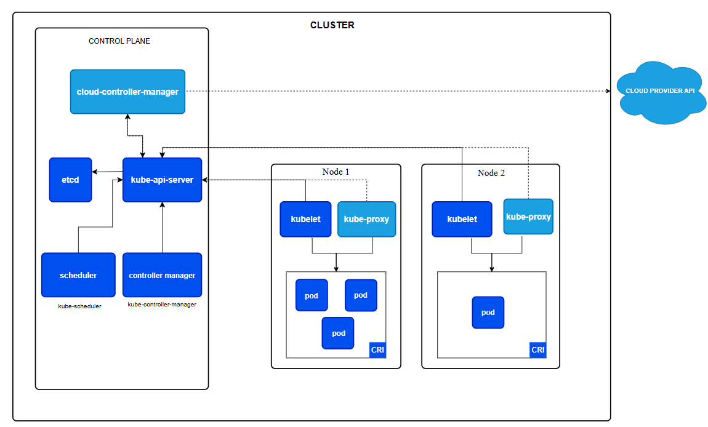
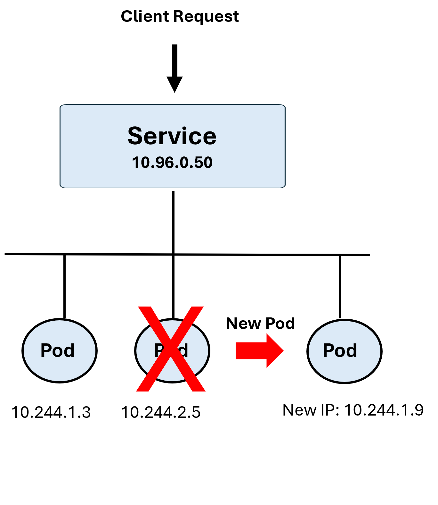

# Kubernetes Architecture and Core Concepts   

Kubernetes is a container orchestration platform composed of multiple components that work together to automate the deployment, scaling, networking, and management of containerized applications https://kubernetes.io/docs/concepts/overview/components/: 


Control Plane Components:  
- __API server__ is the entry point to the Kubernetes cluster. It receives requests from users and tools (such as kubectl) and coordinates communication with other Kubernetes components. It exposes the Kubernetes API i.e. provides a well-defined interface (an HTTP/REST API) that users, tools, and other Kubernetes components can use to communicate with the cluster.
- __etcd__ is a distributed key-value database that stores the Kubernetes cluster configuration and desired state. Etcd contains data to answer questions like:
  - What resources are available?  
  - Did the cluster state change?  
  - Is the cluster healthy?    
- __scheduler__ places pods to a suitable worker node.
- __controller-manager__ watches the K8S cluster for changes, such as a crashed Pod, and automatically takes action to bring the cluster back to its desired state.
- __cloud-controller-manager__ integrates with underlying cloud provider(s).
  
Node Components run on every node, maintaining running pods and providing the Kubernetes runtime environment:  
- __kubelet__ ensures that Pods are running, including their containers.
- __kube-proxy__ maintains network rules on nodes to implement Services.
- __Container runtime__ software responsible for running containers.

Addons extend the functionality of Kubernetes. A few important examples include:
- __DNS__ for cluster-wide DNS resolution.
- __Web UI__ (Dashboard) for cluster management via a web interface.  


  

Kubernetes components work together to create a self-managed, self-healing, and automated cluster:  
- Users define the __desired state__ of the cluster (for example, the number of application instances to run).
- Kubernetes components continuously monitor the __actual state.__
- If a difference is detected (for example, a Pod crashes), Kubernetes automatically detects the issue and takes corrective actions to restore the desired state.

This way applications remain available and operational without manual intervention.  

## Basic Resource types

Deploying an application in Kubernetes involves creating resources, which Kubernetes stores as objects in the etcd database. These objects define the desired state of the system. Kubernetes includes many components, but the foundation for building scalable and resilient applications include the following:  

- __Pod__ is the Atomic Unit of Deployment. In the Kubernetes environment, the smallest and most basic deployable object is not a container, but a Pod. One pod may contain more than one container but the common practice is to have one application container per Pod. The other containers in pod can be init containers to run setup scripts not present in an app image or "sidecar" containers that handle a secondary task, like shipping logs to a central collector etc.
- __Deployment__ is a Kubernetes resource that manages Pods and ensures that the desired number of application instances are running. It is a 'blueprint' of the application. It also provides scaling, updates, self-healing, and rollback capabilities.
- __Service__ is a Kubernetes resource that provides a stable network endpoint (IP address and DNS name) for accessing one or more Pods. Since Pods are ephemeral and their IP addresses can change when they are recreated, a Service provides a permanent address that remains unchanged. It automatically routes and load-balances traffic to the currently available Pods behind the Service.  



Notice: Namespace is a Kubernetes feature that allows a single cluster to be divided into separate virtual environments. It provides a mechanism for isolating groups of resources within a single cluster. Most Kubernetes resources are namespaced, meaning they belong to a specific namespace. If no namespace is specified when creating a resource such as a Deployment, Service, or Pod, Kubernetes automatically creates it in the default namespace.  

## Kubectl  
kubectl is the Kubernetes command-line interface (CLI) used to interact with and manage a Kubernetes cluster. kubectl never communicates directly with worker nodes or etcd; all requests are sent to the Kubernetes API Server, which acts as the central management interface for the cluster. While kubectl is often installed on the control plane by default, administrators typically use it from a separate __workstation__ or bastion host in production environments. 

## Exploring the Kubernetes Cluster
With kubectl it is possible to explore the Kubernetes cluster, observe Kubernetes components in action, and understand how Kubernetes automatically manages applications.


### 1. **Kubernetes installation**  
```
kubectl get nodes
NAME             STATUS   ROLES           AGE     VERSION
ip-172-31-2-6    Ready    <none>          3d20h   v1.37.0
ip-172-31-8-24   Ready    control-plane   3d20h   v1.37.0
```
This command displays the nodes that belong to the cluster and their status.  


### 2. **System Pods**  
```kubectl get pods -n kube-system -o wide``` lists the system Pods installed by Kubernetes. These Pods provide core cluster functionality such as networking, DNS, scheduling, and cluster management.

```
kubectl get pods -n kube-system -o wide
NAME                                      READY   STATUS    RESTARTS   AGE   IP              NODE               NOMINATED NODE   READINESS GATES
calico-kube-controllers-db57f7644-p84dz   1/1     Running   0          50m   192.168.87.67   ip-172-31-7-84     <none>           <none>
calico-node-hwlz2                         1/1     Running   0          47m   172.31.11.215   ip-172-31-11-215   <none>           <none>
calico-node-kqn5f                         1/1     Running   0          50m   172.31.7.84     ip-172-31-7-84     <none>           <none>
coredns-559f6c778d-8xzd6                  1/1     Running   0          50m   192.168.87.65   ip-172-31-7-84     <none>           <none>
coredns-559f6c778d-kxzfl                  1/1     Running   0          50m   192.168.87.66   ip-172-31-7-84     <none>           <none>
etcd-ip-172-31-7-84                       1/1     Running   0          51m   172.31.7.84     ip-172-31-7-84     <none>           <none>
kube-apiserver-ip-172-31-7-84             1/1     Running   0          51m   172.31.7.84     ip-172-31-7-84     <none>           <none>
kube-controller-manager-ip-172-31-7-84    1/1     Running   0          51m   172.31.7.84     ip-172-31-7-84     <none>           <none>
kube-proxy-lwjc6                          1/1     Running   0          47m   172.31.11.215   ip-172-31-11-215   <none>           <none>
kube-proxy-mvh9q                          1/1     Running   0          50m   172.31.7.84     ip-172-31-7-84     <none>           <none>
kube-scheduler-ip-172-31-7-84             1/1     Running   0          51m   172.31.7.84     ip-172-31-7-84     <none>           <none>
```
This command shows also the node where each system Pod is running. Notice, that ```kubelet``` and ```containerd``` are not pods, but Linux system services:  
```
sudo systemctl status kubelet  
sudo systemctl status containerd  
```  


### 3. **How kubectl talks to the Cluster?**  
```kubectl cluster-info``` displays the addresses of the Kubernetes API Server and other cluster services. All communication with a Kubernetes cluster goes through the API Server. Therefore also ```kubectl``` communicates with the cluster by sending requests to the API Server.
```
kubectl cluster-info
Kubernetes control plane is running at https://172.31.8.24:6443
CoreDNS is running at https://172.31.8.24:6443/api/v1/namespaces/kube-system/services/kube-dns:dns/proxy

To further debug and diagnose cluster problems, use 'kubectl cluster-info dump'.
```


### 4. **Kubernetes Context**    
A Kubernetes context is a saved configuration that defines which cluster, user, and namespace ```kubectl``` uses when executing commands. It allows you to easily switch between multiple Kubernetes clusters.   

```
kubectl config get-contexts
CURRENT   NAME                          CLUSTER      AUTHINFO           NAMESPACE
*         kubernetes-admin@kubernetes   kubernetes   kubernetes-admin

```


### 5. **Node Details**  
THe command ```kubectl describe node ip-172-31-2-6``` shows detailed information about a node, including its CPU, memory, labels, conditions, and the Pods currently running on it.  

<details>
<summary>Example output</summary>

```text
kubectl describe node ip-172-31-2-6
Name:               ip-172-31-2-6
Roles:              <none>
Labels:             beta.kubernetes.io/arch=amd64
                    beta.kubernetes.io/os=linux
                    kubernetes.io/arch=amd64
                    kubernetes.io/hostname=ip-172-31-2-6
                    kubernetes.io/os=linux
Annotations:        node.alpha.kubernetes.io/ttl: 0
                    projectcalico.org/IPv4Address: 172.31.2.6/20
                    projectcalico.org/IPv4IPIPTunnelAddr: 192.168.204.0
                    projectcalico.org/Interfaces: [{"name":"ens5","addresses":["172.31.2.6"]}]
                    volumes.kubernetes.io/controller-managed-attach-detach: true
CreationTimestamp:  Thu, 05 Nov 2026 13:08:08 +0000
Taints:             <none>
Unschedulable:      false
Lease:
  HolderIdentity:  ip-172-31-2-6
  AcquireTime:     <unset>
  RenewTime:       Mon, 09 Nov 2026 09:33:42 +0000
Conditions:
  Type                 Status  LastHeartbeatTime                 LastTransitionTime                Reason                       Message
  ----                 ------  -----------------                 ------------------                ------                       -------
  NetworkUnavailable   False   Mon, 09 Nov 2026 09:05:03 +0000   Mon, 09 Nov 2026 09:05:03 +0000   CalicoIsUp                   Calico is running on this node
  MemoryPressure       False   Mon, 09 Nov 2026 09:30:26 +0000   Mon, 09 Nov 2026 09:04:17 +0000   KubeletHasSufficientMemory   kubelet has sufficient memory available
  DiskPressure         False   Mon, 09 Nov 2026 09:30:26 +0000   Mon, 09 Nov 2026 09:04:17 +0000   KubeletHasNoDiskPressure     kubelet has no disk pressure
  PIDPressure          False   Mon, 09 Nov 2026 09:30:26 +0000   Mon, 09 Nov 2026 09:04:17 +0000   KubeletHasSufficientPID      kubelet has sufficient PID available
  Ready                True    Mon, 09 Nov 2026 09:30:26 +0000   Mon, 09 Nov 2026 09:04:17 +0000   KubeletReady                 kubelet is posting ready status
Addresses:
Capacity:
  cpu:                2
  ephemeral-storage:  8217726976
  hugepages-1Gi:      0
  hugepages-2Mi:      0
  memory:             8034780Ki
  pods:               110
Allocatable:
  cpu:                2
  ephemeral-storage:  7395954267
  hugepages-1Gi:      0
  hugepages-2Mi:      0
  memory:             7932380Ki
  pods:               110
System Info:
  Machine ID:                 ec20107dd89b63fc50ad900f5936d1d0
  System UUID:                ec20107d-d89b-63fc-50ad-900f5936d1d0
  Boot ID:                    20c8bf9f-8414-4308-a2d6-00c625c590ea
  Kernel Version:             6.12.115+deb13.1-cloud-amd64
  OS Image:                   Debian GNU/Linux 13 (trixie)
  Operating System:           linux
  Architecture:               amd64
  Container Runtime Version:  containerd://1.7.24
  Kubelet Version:            v1.37.0
PodCIDR:                      192.168.1.0/24
PodCIDRs:                     192.168.1.0/24
Non-terminated Pods:          (3 in total)
  Namespace                   Name                            CPU Requests  CPU Limits  Memory Requests  Memory Limits  Age
  ---------                   ----                            ------------  ----------  ---------------  -------------  ---
  default                     apache-demo-6b765b66c4-xfhmz    0 (0%)        0 (0%)      0 (0%)           0 (0%)         3d20h
  kube-system                 calico-node-zdzvk               250m (12%)    0 (0%)      0 (0%)           0 (0%)         3d20h
  kube-system                 kube-proxy-kjbdv                0 (0%)        0 (0%)      0 (0%)           0 (0%)         3d20h
Allocated resources:
  (Total limits may be over 100 percent, i.e., overcommitted.)
  Resource           Requests    Limits
  --------           --------    ------
  cpu                250m (12%)  0 (0%)
  memory             0 (0%)      0 (0%)
  ephemeral-storage  0 (0%)      0 (0%)
  hugepages-1Gi      0 (0%)      0 (0%)
  hugepages-2Mi      0 (0%)      0 (0%)
Events:
  Type     Reason                   Age                From             Message
  ----     ------                   ----               ----             -------
  Normal   RegisteredNode           31m                node-controller  Node ip-172-31-2-6 event: Registered Node ip-172-31-2-6 in Controller
  Normal   NodeNotReady             30m                node-controller  Node ip-172-31-2-6 status is now: NodeNotReady
  Normal   Starting                 29m                kubelet          Starting kubelet.
  Warning  Rebooted                 29m                kubelet          Node ip-172-31-2-6 has been rebooted, boot id: 20c8bf9f-8414-4308-a2d6-00c625c590ea
  Normal   NodeHasSufficientMemory  29m (x3 over 29m)  kubelet          Node ip-172-31-2-6 status is now: NodeHasSufficientMemory
  Normal   NodeHasNoDiskPressure    29m (x3 over 29m)  kubelet          Node ip-172-31-2-6 status is now: NodeHasNoDiskPressure
  Normal   NodeHasSufficientPID     29m (x3 over 29m)  kubelet          Node ip-172-31-2-6 status is now: NodeHasSufficientPID
  Normal   NodeNotReady             29m                kubelet          Node ip-172-31-2-6 status is now: NodeNotReady
  Normal   NodeReady                29m                kubelet          Node ip-172-31-2-6 status is now: NodeReady
```
</details>


### 6. **Create the First Pod**  
Create a pod that is running the NGINX web server.  
```
kubectl run nginx --image=nginx
pod/nginx created
```
To verify that the pod is running:  

```
kubectl get pods
NAME                           READY   STATUS    RESTARTS      AGE
nginx                          1/1     Running   0             15s
```
To inspect the pod run the command ```kubectl describe pod nginx```  

<details>
<summary>Example output</summary>

```text
kubectl describe pod nginx
Name:             nginx
Namespace:        default
Priority:         0
Service Account:  default
Node:             ip-172-31-15-152/172.31.15.152
Start Time:       Mon, 09 Nov 2026 11:10:13 +0000
Labels:           run=nginx
Annotations:      cni.projectcalico.org/containerID: 8d1ccfee4b0e528953575f0a516c6a114637386268135b8eaba203672a1482ba
                  cni.projectcalico.org/podIP: 192.168.218.129/32
                  cni.projectcalico.org/podIPs: 192.168.218.129/32
Status:           Running
IP:               192.168.218.129
IPs:
  IP:  192.168.218.129
Containers:
  nginx:
    Container ID:   containerd://0446eb794fd79261d3523ffd8aa77dffaafe446408415bf9a150d7fef42c3e43
    Image:          nginx
    Image ID:       docker.io/library/nginx@sha256:165ddde8751e75a1c907d24ef10d9f6deb08b57e0fe56caf67512486aff76d82
    Port:           <none>
    Host Port:      <none>
    State:          Running
      Started:      Mon, 09 Nov 2026 11:10:18 +0000
    Ready:          True
    Restart Count:  0
    Environment:    <none>
    Mounts:
      /var/run/secrets/kubernetes.io/serviceaccount from kube-api-access-hnkg9 (ro)
Conditions:
  Type                        Status
  PodReadyToStartContainers   True
  Initialized                 True
  Ready                       True
  ContainersReady             True
  PodScheduled                True
Volumes:
  kube-api-access-hnkg9:
    Type:                    Projected (a volume that contains injected data from multiple sources)
    TokenExpirationSeconds:  3607
    ConfigMapName:           kube-root-ca.crt
    Optional:                false
    DownwardAPI:             true
QoS Class:                   BestEffort
Node-Selectors:              <none>
Tolerations:                 node.kubernetes.io/not-ready:NoExecute op=Exists for 300s
                             node.kubernetes.io/unreachable:NoExecute op=Exists for 300s
Events:
  Type    Reason     Age   From               Message
  ----    ------     ----  ----               -------
  Normal  Scheduled  33s   default-scheduler  Successfully assigned default/nginx to ip-172-31-15-152
  Normal  Pulling    32s   kubelet            spec.containers{nginx}: Pulling image "nginx"
  Normal  Pulled     29s   kubelet            spec.containers{nginx}: Successfully pulled image "nginx" in 3.799s (3.799s including waiting). Image size: 63933865 bytes.
  Normal  Created    28s   kubelet            spec.containers{nginx}: Container created
  Normal  Started    28s   kubelet            spec.containers{nginx}: Container started
```
</details>

```kubectl logs nginx``` shows the container logs:   
<details>
<summary>Example output</summary>

```text

kubectl logs nginx
/docker-entrypoint.sh: /docker-entrypoint.d/ is not empty, will attempt to perform configuration
/docker-entrypoint.sh: Looking for shell scripts in /docker-entrypoint.d/
/docker-entrypoint.sh: Launching /docker-entrypoint.d/10-listen-on-ipv6-by-default.sh
10-listen-on-ipv6-by-default.sh: info: Getting the checksum of /etc/nginx/conf.d/default.conf
10-listen-on-ipv6-by-default.sh: info: Enabled listen on IPv6 in /etc/nginx/conf.d/default.conf
/docker-entrypoint.sh: Sourcing /docker-entrypoint.d/15-local-resolvers.envsh
/docker-entrypoint.sh: Launching /docker-entrypoint.d/20-envsubst-on-templates.sh
/docker-entrypoint.sh: Launching /docker-entrypoint.d/30-tune-worker-processes.sh
/docker-entrypoint.sh: Configuration complete; ready for start up
2026/11/09 11:10:18 [notice] 1#1: using the "epoll" event method
2026/11/09 11:10:18 [notice] 1#1: nginx/1.31.8
2026/11/09 11:10:18 [notice] 1#1: built by gcc 14.2.0 (Debian 14.2.0-19)
2026/11/09 11:10:18 [notice] 1#1: OS: Linux 6.12.115+deb13.1-cloud-amd64
2026/11/09 11:10:18 [notice] 1#1: getrlimit(RLIMIT_NOFILE): 1073741816:1073741816
2026/11/09 11:10:18 [notice] 1#1: start worker processes
2026/11/09 11:10:18 [notice] 1#1: start worker process 29
2026/11/09 11:10:18 [notice] 1#1: start worker process 30
```
</details>  

It is also possible to execute commands inside the container:  

```
kubectl exec -it nginx -- bash
root@nginx:/#

root@nginx:/# hostname
nginx
root@nginx:/#
```


### 7. **The Desired State**  
A Deployment configured with three Nginx Pod replicas defines the desired state of the application. Kubernetes continuously compares the actual state of the cluster with the desired state and automatically creates or removes Pods as needed to maintain three running replicas.

```
kubectl create deployment nginx --image=nginx --replicas=3
deployment.apps/nginx created
```
To check the outcome run the following commands:  
```
kubectl get deployments
NAME    READY   UP-TO-DATE   AVAILABLE   AGE
nginx   3/3     3            3           21s

kubectl get replicasets
NAME               DESIRED   CURRENT   READY   AGE
nginx-69b9cdbbdd   3         3         3       29s

kubectl get pods
NAME                     READY   STATUS    RESTARTS   AGE
nginx-69b9cdbbdd-bhrq2   1/1     Running   0          38s
nginx-69b9cdbbdd-fpkfw   1/1     Running   0          38s
nginx-69b9cdbbdd-hblt2   1/1     Running   0          38s
```


### 8. **Controller Manager**  
To demonstrate Kubernetes' self-healing capabilities, delete one of the Pods using ```kubectl delete pod <pod-name>``` and immediately run ```kubectl get pods -w```. Kubernetes will automatically create a new Pod to maintain the desired number of replicas (= desired state) defined by the Deployment.
```
kubectl get pods
NAME                     READY   STATUS    RESTARTS   AGE
nginx-69b9cdbbdd-dxlmm   1/1     Running   0          81s
nginx-69b9cdbbdd-nxf2q   1/1     Running   0          24s
nginx-69b9cdbbdd-qckq2   1/1     Running   0          2m26s

kubectl delete pod nginx-69b9cdbbdd-qckq2
pod "nginx-69b9cdbbdd-qckq2" deleted from default namespace

kubectl get pods -w
NAME                     READY   STATUS    RESTARTS   AGE
nginx-69b9cdbbdd-dxlmm   1/1     Running   0          102s
nginx-69b9cdbbdd-gbqp9   1/1     Running   0           5s
nginx-69b9cdbbdd-nxf2q   1/1     Running   0          45s

```
This shows that old pod is deleted and a new pod is created immediately. Controller Manager detects the difference in the actual and desired state and recreates the Pod.  


### 9. **Scheduler**  
When scaling the deployment Kubernetes creates required number of additional Pods. The Scheduler selects appropriate nodes for the new Pods based on available resources and scheduling rules.  
```
kubectl scale deployment nginx --replicas=5
deployment.apps/nginx scaled

kubectl get pods -o wide
NAME                     READY   STATUS    RESTARTS   AGE     IP                NODE               NOMINATED NODE   READINESS GATES
nginx-69b9cdbbdd-dxlmm   1/1     Running   0          2m35s   192.168.204.69    ip-172-31-2-64     <none>           <none>
nginx-69b9cdbbdd-gbqp9   1/1     Running   0          58s     192.168.218.134   ip-172-31-15-152   <none>           <none>
nginx-69b9cdbbdd-mct4g   1/1     Running   0          14s     192.168.204.70    ip-172-31-2-64     <none>           <none>
nginx-69b9cdbbdd-ntvj4   1/1     Running   0          14s     192.168.218.135   ip-172-31-15-152   <none>           <none>
nginx-69b9cdbbdd-nxf2q   1/1     Running   0          98s     192.168.218.133   ip-172-31-15-152   <none>           <none>

```


### 10. **Service**  
A service exposes the pods managed by the deployment. It provides a stable IP address (network endpoint) for accessing the application even individual pods are recreated or their IP address change.  
A service can be exposed with command ```kubectl expose deployment nginx --port=80``` and verified with ```kubectl get svc``` and ```kubectl describe svc nginx``` commands. 

<details>
<summary>Example output</summary>

```text

kubectl expose deployment nginx --port=80
service/nginx exposed

kubectl get svc
NAME         TYPE        CLUSTER-IP       EXTERNAL-IP   PORT(S)   AGE
kubernetes   ClusterIP   10.96.0.1        <none>        443/TCP   17m
nginx        ClusterIP   10.107.242.143   <none>        80/TCP    23s

kubectl describe svc nginx
Name:                     nginx
Namespace:                default
Labels:                   app=nginx
Annotations:              <none>
Selector:                 app=nginx
Type:                     ClusterIP
IP Family Policy:         SingleStack
IP Families:              IPv4
IP:                       10.107.242.143
IPs:                      10.107.242.143
Port:                     <unset>  80/TCP
TargetPort:               80/TCP
Endpoints:                192.168.204.70:80,192.168.218.133:80,192.168.218.135:80 + 2 more...
Session Affinity:         None
Internal Traffic Policy:  Cluster
Events:                   <none>
```
</details> 

Curl can be used to test the connectivity to the nginx service (```curl <nginx CLUSTER-IP>```):  
```
curl 10.107.242.143
<!DOCTYPE html>
<html>
<head>
<title>Welcome to nginx!</title>
...
</head>
<body>
<h1>Welcome to nginx!</h1>
...
</body>
</html>
```


### 11. **DNS**
Kubernetes includes an **internal** DNS service that automatically creates DNS records for Services. As a result, applications running in the cluster can communicate using easy-to-remember Service names rather than IP addresses. To explore Kubernetes DNS and Service discovery, the queries must be executed from within the Kubernetes cluster. For this purpose, a temporary debug Pod is created and an interactive shell is opened inside it.  

```
kubectl run debug --image=busybox --restart=Never -it -- sh
All commands and output from this session will be recorded in container logs, including credentials and sensitive information passed through the command prompt.
If you don't see a command prompt, try pressing enter.
/ #
```
To resolve the Service name ```nslookup``` is used:  
```
/ # nslookup nginx
Server:         10.96.0.10
Address:        10.96.0.10:53
...
Name:   nginx.default.svc.cluster.local
Address: **10.107.242.143**
...
```
It is also possible to access the Service (nginx web server) using its DNS name:  
```
/ # wget -qO- http://nginx
<!DOCTYPE html>
<html>
<head>
<title>Welcome to nginx!</title>
...
</head>
<body>
<h1>Welcome to nginx!</h1>

...
</body>
</html>
/ #
```
The nginx welcome page opens which shows how Kubernetes DNS allows applications to communicate using Service names instead of IP addresses.  


### 12. **Summary of Kubernetes Objects**  

```
kubectl get all
NAME                         READY   STATUS      RESTARTS   AGE
pod/debug                    0/1     Completed   0          2m39s
pod/nginx-69b9cdbbdd-dxlmm   1/1     Running     0          8m50s
pod/nginx-69b9cdbbdd-gbqp9   1/1     Running     0          7m13s
pod/nginx-69b9cdbbdd-mct4g   1/1     Running     0          6m29s
pod/nginx-69b9cdbbdd-ntvj4   1/1     Running     0          6m29s
pod/nginx-69b9cdbbdd-nxf2q   1/1     Running     0          7m53s

NAME                 TYPE        CLUSTER-IP       EXTERNAL-IP   PORT(S)   AGE
service/kubernetes   ClusterIP   10.96.0.1        <none>        443/TCP   22m
service/nginx        ClusterIP   10.107.242.143   <none>        80/TCP    5m44s

NAME                    READY   UP-TO-DATE   AVAILABLE   AGE
deployment.apps/nginx   5/5     5            5           12m

NAME                               DESIRED   CURRENT   READY   AGE
replicaset.apps/nginx-69b9cdbbdd   5         5         5       12m

```
This displays the main Kubernetes objects in the current namespace, including Pods, Deployments, ReplicaSets, and Services which together form a running application.   
The namespaces can be checked with ```kubectl get deployments -A```  

```
kubectl get deployments -A
NAMESPACE     NAME                      READY   UP-TO-DATE   AVAILABLE   AGE
default       nginx                     3/3     3            3           44m
kube-system   calico-kube-controllers   1/1     1            1           4h32m
kube-system   coredns                   2/2     2            2           4h32m
```
Application deployments are created in the default namespace unless another namespace is explicitly specified.  

### From Deployment Request to Running Container
The diagram below illustrates the relationships between the main Kubernetes components and how they work together.  

```
kubectl
    |
    v
+--------------+
|  API Server  |
+--------------+
    |
    +------------------------+
    |                        |
    v                        v
etcd                 Controller Manager
                              |
                              v
                         Scheduler
                              |
                              v
                         Worker Node
                              |
                              v
                           kubelet
                              |
                              v
                              Pod
                              |
                              v
                         Container
                              |
                              v
                        nginx process
(AI assisted chart)
```


