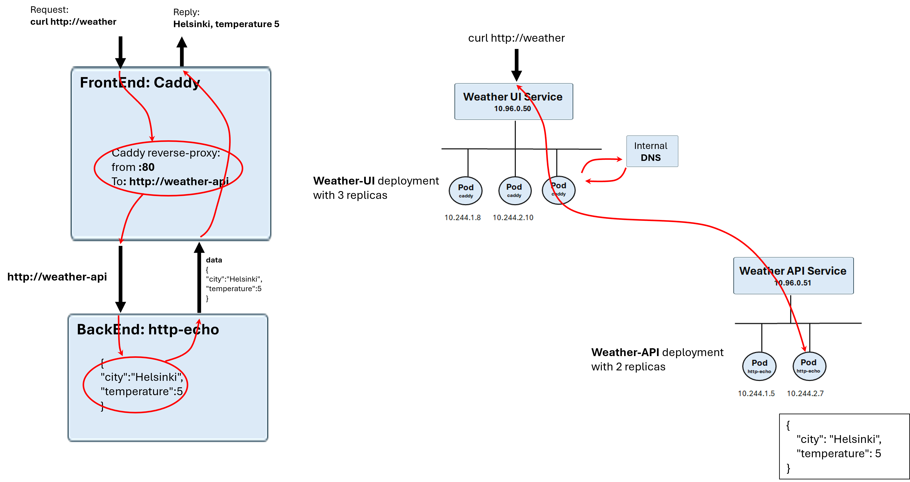
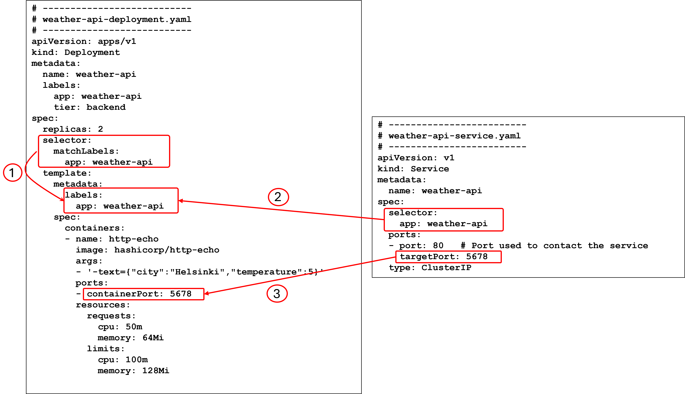
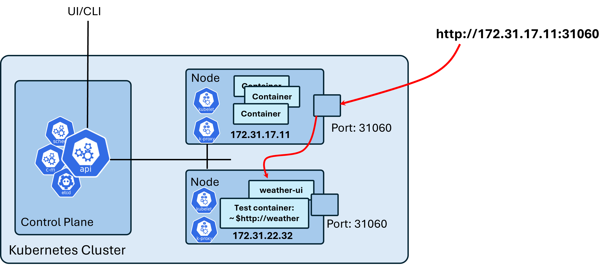
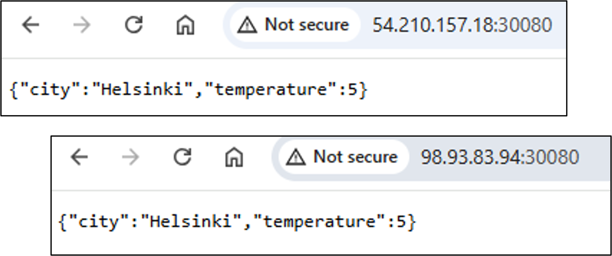

# Deploying the First Complete Application: Networking, Configuration, and Scaling

Simple nginx application was created with two commands. 
```
kubectl create deployment nginx --image=nginx
kubectl expose deployment nginx --port=80 --type=ClusterIP
```
As applications grow, managing their components becomes complex. Even a small microservices-based application can consist of multiple independently deployed services that must communicate with each other. 

## **Example**: Simple Weather application  
This weather application is built using a microservices architecture and consists of two independent microservices, each running in its own container:  
- Frontend: **Weather UI** Container acts as a reverse proxy. All requests to ```http://weather``` will be forwarded to backend container. Frontend   
    -  Is the user interface that receives weather requests from users.
    -  Sends requests to the backend Weather API container to obtain weather information.
    -  Implemented using Caddy, open-source web server with built-in reverse proxy capabilities

- Backend: **Weather API** Container echoes back a static response representing the typical November weather in Helsinki (for demonstration purposes)
    - Processes weather data requests.
    - Retrieves and returns weather information to the Weather UI container.
    - Exposes a simple HTTP API that listens on port 5678 consumed by the frontend service. 
    - Implemented using HashiCorp HTTP Echo.




### 1. Create the Weather API Deployment (backend)  
```kubectl create deployment weather-api --image=hashicorp/http-echo -- /http-echo -text='{"city":"Helsinki","temperature":5}'```  
The deployment:  
- creates a ReplicaSet (contains as default one pod)  
- The ReplicaSet creates a Pod  
- The Pod runs a container based on the hashicorp/http-echo image. It starts HTTP Echo server and configures it to return the text specified.
  
### 2. Create Weather API Service  
```kubectl expose deployment weather-api --port=80 --target-port=5678``` creates a service named weather-api that exposes the Weather API. This service    
- Provides a stable IP address.  
- Provides DNS name weather-api.  
- Load balances traffic to API Pods.
  
### 3. Create the Weather UI Deployment (frontend)  
```create deployment weather-ui --image=caddy -- caddy reverse-proxy --from :80 --to http://weather-api``` creates deployment named weather-ui. The pods run a caddy web server that acts as a reverse proxy.

### 4. Expose the Weather UI service    
```kubectl expose deployment weather-ui --name=weather --port=80 --target-port=80``` creates a service named weather. It gives users a stable endpoint (```http://weather```) to reach the frontend.

### 5. Set Resource Requirements  
```kubectl set resources deployment weather-api --limits=cpu=100m,memory=128Mi --requests=cpu=50m,memory=64Mi```  
```kubectl set resources deployment weather-ui --limits=cpu=200m,memory=256Mi --requests=cpu=100m,memory=128Mi```  
Requests are reserved when scheduling the Pod. The container cannot exceed the limits. Requests and limits help Kubernetes to schedule pods efficiently, make resource usage predictable and prevent one container from monopolizing resources. The UI container is expected to need more resources than the simple HTTP Echo backend.

### 6. Scale the deployments  
```kubectl scale deployment weather-api --replicas=2``` and ```kubectl scale deployment weather-ui --replicas=3``` change the desired replica count in deployments.

### 7. Label the deployments  
```kubectl label deployment weather-api tier=backend``` and ```kubectl label deployment weather-ui tier=frontend``` labels allow Kubernetes objects to be grouped and selected. This way frontend and backend components can be managed separately, for example ```kubectl get deployments -l tier=frontend``` returns only frontend Deployments.

### 8. Test the new microservices based application.
Currently the application is accessible only inside the Kubernetes cluster. To test the weather application    
- start a test container: ```kubectl run curl-test --image=curlimages/curl -it --rm --restart=Never -- sh```
- run the test inside this container:
```
~ $ curl http://weather
{"city":"Helsinki","temperature":5}
```
- check the Kubernetes internal DNS:  
```
~ $ nslookup weather.default.svc.cluster.local.
Server:         10.96.0.10
Address:        10.96.0.10:53

Name:   weather.default.svc.cluster.local
Address: 10.107.226.50
```
```default.svc.cluster.local``` is automatically constructed by Kubernetes' node agent (kubelet) when the Pod is created. It combines the Pod's current namespace (default), the standard Kubernetes resource identifier for Services (svc), and the cluster's base DNS domain (cluster.local).

### **Conclusion:**  
As the application grows, manually creating and configuring all deployments, services, labels, replicas, resource limits etc. through individual kubectl commands becomes increasingly complex. Questions arise:  
- What exactly did I create?  
- Can I recreate the same environment tomorrow?  
- Can I version-control it in Git?  
- How do I move it to another cluster?  
 

## Manifests

The solution is to define the entire application configuration declaratively by using manifests. YAML is a human-readable data format used to write Kubernetes configuration files. The main components of Kubernetes YAML file are  
- **api version**
- **kind** specifies what type of object (pod, deployment, service etc.) is created
- **metadata** identifies the object including name and labels
- **spec** defines the desired state

**Example:** pod.yaml  

```
# --------
# pod.yaml
# --------
apiVersion: v1
kind: Pod
metadata:
  name: my-nginx-pod
  labels:
    env: test
spec:
  containers:
  - name: nginx
    image: nginx
```
Notice that YAML has very strict line separation & indentation. It uses spaces (never tabs) to show hierarchy. Every nested item must line up with the exact same number of spaces (usually 2 spaces per level). It is also a good practice to check manifest files with an online YAML validator (for example https://yamltools.dev/en/kubernetes-yaml-validator) or a code editor plugin like VS Code Kubernetes extension before deploying them to catch spacing errors early.  

There is rarely need to write YAML files from scratch — instead it is possible to quickly generate template by using ```kubectl``` command with ```--dry-run``` option which only simulates a command without actually creating, modifying, or deleting anything in the cluster. Here is an example:  
```
kubectl run mypod --image=nginx:latest --labels=test  --dry-run=client -o yaml > mypod.yaml
```
It is also a common practice to copy-paste a working template and adjust it.  

### **Connecting Components with Labels and Selectors**

A Deployment manages application Pods, while a Service provides a single, stable network entry point to reach them. Kubernetes connects these components dynamically by answering three key questions:  

**1.** How does a Deployment know which Pods belong to it?  
- The Deployment uses its selector field to find and manage any Pods carrying matching labels (defined in the Pod template).  
  
**2.** How does a Service know where to route traffic?  
- When a container calls another Service by name (such as http://weather-api), Kubernetes' built-in DNS (CoreDNS) first translates that name into the target Service's IP address. This is called service discovery. After that a service uses its own selector to find matching Pods and sends traffic straight to their IP addresses.  

**3.** Which port does the Service send traffic to?  
- Inside the Pod, containerPort marks the port the application is listening on. Once the Service finds the right Pods, it uses targetPort to forward traffic directly to that matching containerPort.



**Example:**  
<details>
<summary>Simple Weather Application YAML files </summary>

```text

# -------------------------
# weather-api-deployment.yaml
# -------------------------
apiVersion: apps/v1
kind: Deployment
metadata:
  name: weather-api
  labels:
    app: weather-api
    tier: backend
spec:
  replicas: 2
  selector:
    matchLabels:
      app: weather-api
  template:
    metadata:
      labels:
        app: weather-api
    spec:
      containers:
      - name: http-echo
        image: hashicorp/http-echo
        args:
        - '-text={"city":"Helsinki","temperature":5}'
        ports:
        - containerPort: 5678
        resources:
          requests:
            cpu: 50m
            memory: 64Mi
          limits:
            cpu: 100m
            memory: 128Mi
---
# -------------------------
# weather-api-service.yaml
# -------------------------
apiVersion: v1
kind: Service
metadata:
  name: weather-api
spec:
  selector:
    app: weather-api
  ports:
  - port: 80
    targetPort: 5678
  type: ClusterIP

---
# -------------------------
# weather-ui-deployment.yaml
# -------------------------

apiVersion: apps/v1
kind: Deployment
metadata:
  name: weather-ui
  labels:
    app: weather-ui
    tier: frontend
spec:
  replicas: 3
  selector:
    matchLabels:
      app: weather-ui
  template:
    metadata:
      labels:
        app: weather-ui
    spec:
      containers:
      - name: caddy
        image: caddy
        args: ["caddy", "reverse-proxy", "--from=:80", "--to=http://weather-api"]
        ports:
        - containerPort: 80
        resources:
          requests:
            cpu: 100m
            memory: 128Mi
          limits:
            cpu: 200m
            memory: 256Mi
---
# -------------------------
# weather-ui-service.yaml
# -------------------------

apiVersion: v1
kind: Service
metadata:
  name: weather
spec:
  selector:
    app: weather-ui
  ports:
  - port: 80
    targetPort: 80
  type: ClusterIP
```
</details>

Apply all manifests:  
```
kubectl apply -f weather-api-deployment.yaml
kubectl apply -f weather-api-service.yaml
kubectl apply -f weather-ui-deployment.yaml
kubectl apply -f weather-ui-service.yaml
```
or alternatively  
```kubectl apply -f .```

Check the outcome:  
```
kubectl get deployment weather-api -o yaml
kubectl get deployment weather-ui -o yaml
```


## Kubernetes Networking

The weather application was tested by starting a test container and running the test inside this container, because so far the weather application is accessible only inside the Kubernetes cluster. As discussed earlier Pods are ephemeral — they come and go, get rescheduled, and their IP addresses change. Service is a concept that offers a stable IP address (and DNS name) that distributes traffic across a set of Pods. Kubernetes provides several Service types for different use cases:
- **ClusterIP** (default): Creates a virtual IP accessible only within the cluster, this is currently used in weather application.
- **NodePort:** Exposes the Service on a port (30000–32767) on every node. External traffic can reach the service with ```http://<node-ip>:<nodeport>```. However, there is no external DNS available. This can be used in testing and demos, but is not recommended in production environments.  
- **LoadBalancer**: Exposes a Service externally by provisioning a load balancer. In cloud environments, Kubernetes typically integrates with the cloud provider's load-balancing service which is the standard way to expose a service to the Internet. However, creating a separate load balancer for every Service can be costly and difficult to manage. **Ingress** solves this problem. It acts as a smart traffic router that manages external HTTP(S) access to the services.

**Example:** Simple Weather Application with NodePort  




To start using __nodeport__ change the weather-ui service yaml:  

```
# -------------------------
# weather-ui-service.yaml
# -------------------------
apiVersion: v1
kind: Service
metadata:
  name: weather
spec:
  selector:
    app: weather-ui
  ports:
  - port: 80
    targetPort: 80
    nodePort: 30080
  type: NodePort
```
Apply changes: ```kubectl apply -f weather-ui-service.yaml```  and verify the outcome:  
(Notice: the name of the service is weather, not weather-ui)   

```
kubectl get svc
NAME          TYPE        CLUSTER-IP       EXTERNAL-IP   PORT(S)        AGE
kubernetes    ClusterIP   10.96.0.1        <none>        443/TCP        8m24s
weather       NodePort    10.109.80.195    <none>        80:30080/TCP   4m1s
weather-api   ClusterIP   10.110.226.103   <none>        80/TCP         4m1s
```

Now it is possible to access the weather application through any cluster node: ```http://<node-ip>:30080```  This can be tested with curl and/or browser.  

```
Node private IP-addresses:  
curl http://172.31.22.32:30080
{"city":"Helsinki","temperature":5}
curl http://172.31.17.11:30080
{"city":"Helsinki","temperature":5}

Node public IP-addresses:  
curl http://98.93.83.94:30080
{"city":"Helsinki","temperature":5}
curl http://54.210.157.18:30080
{"city":"Helsinki","temperature":5}

```



