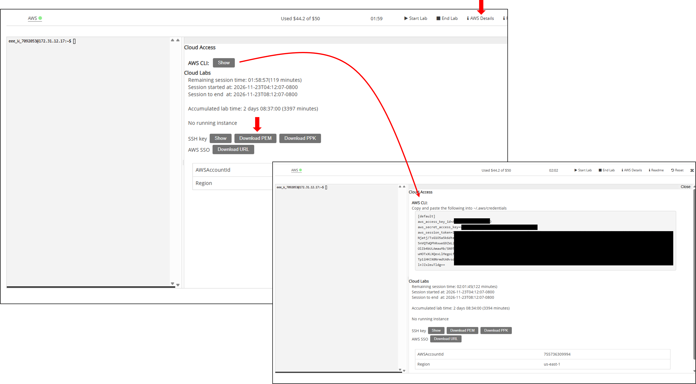

## Workstation

A workstation is required to install and manage Kubernetes, use the AWS CLI, and run Terraform. Before starting, the workstation must be properly configured with the necessary tools and access credentials.  

These instructions use an Amazon EC2 instance running Debian 13.x as the workstation. However, any Linux workstation can be used, including a physical PC, laptop, virtual machine, or cloud-based Linux instance. General workstation setup instructions are available here: https://github.com/johannaheinonen/johanna-test-repo/blob/main/module_6.md  


### EC2 
  
The workstation EC2 instance is launched from the AWS Management Console using the following parameters:
- name: workstation  
- Amazon Machine image (AMI): debian  
- instance type: t2.micro  
- security group: Create a new security group and enable SSH access  
- key pair: vockey  
- IAM instance profile: LabInstanceProfile (Advanced details -> IAM Instance profile)  

Other parameters can be left at their default values.  

Next connect to the EC2 instance using SSH. For this download the SSH key (labsuser.pem) from AWS Academy learner lab. (If the local machine is linux/MacOS change the permissions: ```chmod 400 labsuser.pem```.)  



```ssh -i labsuser.pem admin@<EC2-public-IP>```  

__Required Tools__  
In EC2 instance the **AWS CLI** is already installed and available. If using other workstation than EC2, AWS CLI must be separately installed. In both cases AWS credentials need to be exported from AWS Learner Lab.  
Notice: These credentials must be exported **every time** the Learner Lab environment is started.  
  
```
export AWS_ACCESS_KEY_ID="..."
export AWS_SECRET_ACCESS_KEY="..."
export AWS_SESSION_TOKEN="..."
export AWS_DEFAULT_REGION="eu-north-1"
```
To test that aws cli is working properly run the command:  
```
aws sts get-caller-identity
{
    "UserId": "AROA275XXXXXXXXXX:user561XXXX=_Student_View__N_N",
    "Account": "75573XXXXXX",
    "Arn": "arn:aws:sts::75573XXXXXX:assumed-role/voclabs/user561XXXX=_Student_View__N_N"
}
```
Install **terraform** with script ```install_terraform.sh```  
Install **kubectl** with script ```install_kubectl.sh```  

**After** Kubernetes is installed, copy the ```~/.kube/config``` from the Kubernetes controller node to the workstation and set its permissions to 600. This restricts access to the file so that only the current user can read and modify it.  
```
mkdir ~/.kube
scp -i labsuser.pem admin@<K8s controller IP-address>:~/.kube/config ~/.kube/config

chmod 600 ~/.kube/config
```
Notice: In a kubeadm-based Kubernetes cluster, the original administrator kubeconfig file is stored at: ```/etc/kubernetes/admin.conf``` but during the cluster setup it is copied to ```~/.kube/config```. To check what is stored in config file (```~/.kube/config```) run the command:    
```
kubectl config view
```

To test that kubectl is working properly run the command:  ```kubectl get nodes```  

      
